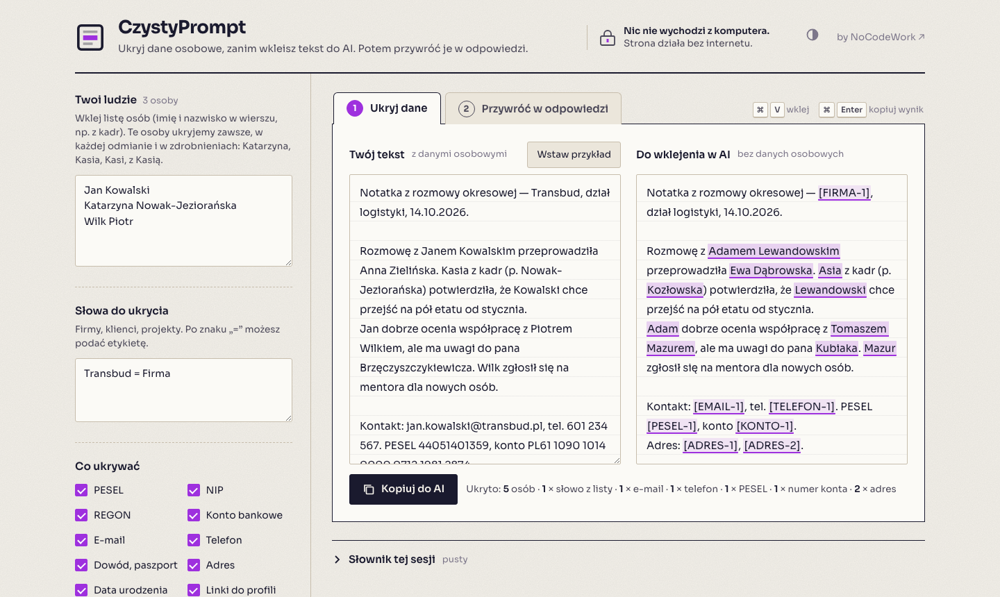

<div align="center">

# CzystyPrompt

**Ukryj dane osobowe, zanim wkleisz tekst do AI. Potem przywróć je w odpowiedzi — w poprawnej odmianie.**

Jeden plik HTML. Działa w przeglądarce, bez instalacji i bez internetu. Open source (MIT).


**[czystyprompt.nocodework.io](https://czystyprompt.nocodework.io)**



</div>

## Po co

Chcesz, żeby ChatGPT, Claude albo Copilot pomógł ci z notatką z rozmowy okresowej, opinią o pracowniku czy mailem do kandydata. Ale w tekście są nazwiska, PESEL-e i telefony. CzystyPrompt podmienia je na zmyślone dane, ty wysyłasz do AI wersję bez danych osobowych, a odpowiedź wklejasz z powrotem — CzystyPrompt wstawia prawdziwe nazwiska tam, gdzie AI użyło zmyślonych.

Czym różni się od innych anonimizatorów:

- **Odmiana przez przypadki.** Polskie nazwiska się odmieniają. Jeśli AI napisze „porozmawiaj z Adamem Lewandowskim”, CzystyPrompt wstawi „porozmawiaj z Janem Kowalskim”, a nie „z Jan Kowalski”.
- **Lista „Twoi ludzie”.** Wklejasz listę osób (np. z kadr) i te osoby są ukrywane zawsze: w każdej odmianie, w zdrobnieniach (Katarzyna, Kasia, Kasi, z Kasią), z samym nazwiskiem albo inicjałem.
- **Naturalne pseudonimy.** Zamiast `[OSOBA-1]` AI dostaje zmyślone imię i nazwisko tej samej płci i podobnego wzoru odmiany, więc pisze naturalnie i nie gubi kontekstu. Znaczniki `[OSOBA-1]` też są do wyboru.
- **Zero sieci.** Strona ma wpisaną blokadę (Content Security Policy), która nie pozwala jej niczego wysłać ani pobrać. Otwórz kartę Sieć w narzędziach przeglądarki i sprawdź.

## Jak używać

1. Wejdź na [czystyprompt.nocodework.io](https://czystyprompt.nocodework.io) albo otwórz [`index.html`](index.html) z dysku (link „Pobierz na dysk” na dole strony) — działa też bez internetu.
2. Opcjonalnie wklej listę osób i słowa do ukrycia (np. `Transbud = Firma`).
3. Wklej tekst w kroku 1 i kliknij **Kopiuj do AI** (albo `Ctrl/⌘ + Enter`).
4. Odpowiedź AI wklej w kroku 2 i skopiuj wersję z prawdziwymi danymi.

Słownik podmian żyje w karcie przeglądarki. Jeśli odpowiedź z AI przyjdzie później, zapisz sesję do pliku i wczytaj ją, gdy będzie potrzebna. Ten plik zawiera prawdziwe dane, więc trzymaj go u siebie.

## Co rozpoznaje

| Rodzaj | Jak |
|---|---|
| Osoby z twojej listy | wszystkie formy odmiany, zdrobnienia, samo nazwisko, inicjał, nazwiska dwuczłonowe |
| Inne imiona i nazwiska | ok. 1,6 tys. imion i 35 tys. nazwisk z rejestru PESEL (ok. 87% populacji), tytuły („pan”, „dr”), typowe końcówki (-ski, -wicz, -czyk) |
| PESEL, NIP, REGON, numer konta, karta, dowód osobisty | wzorzec + suma kontrolna (przypadkowe liczby nie są brane za PESEL) |
| E-mail, telefon, adres, kod pocztowy, data urodzenia, linki do profili | wzorce |
| Kwoty, wszystkie daty | do włączenia w ustawieniach |
| Dane o zdrowiu, wyznaniu, związkach zawodowych, karalności | **tylko ostrzeżenie** — to treść, nie identyfikator; decyzja należy do ciebie |

## Jak dobrze działa

Pomiar na syntetycznych zdaniach (`node scripts/bench.mjs 5000`), imiona i nazwiska losowane z rejestru PESEL, wszystkie przypadki:

| Miara | Wynik |
|---|---|
| Ukryte osoby | 99,9% |
| Ukryj → przywróć daje dokładnie oryginał | 99,9% |
| AI użyło pseudonimu w **innym** przypadku → poprawna forma prawdziwego nazwiska | 99,6% |
| Fałszywe trafienia na tekście bez osób (miasta, instytucje, „Piątek”, „Wilk”) | 0 na 151 słów |

**Gdzie są luki.** Rzadkie nazwisko (spoza słownika) użyte samo, bez imienia i bez „pan/pani”, wykrywamy w ok. 37% przypadków. Z imieniem albo tytułem — w 100%. Dlatego dla swoich pracowników wklej listę: wtedy wykrycie nie zależy od słownika. Inne ograniczenia:

- nie rozpoznajemy danych w obrazach i skanach,
- ksywki spoza listy zdrobnień („Kowal”, „Szefowa”) i opisy pozwalające zgadnąć osobę („jedyna kobieta w dziale IT”) zostają w tekście,
- przy formach dwuznacznych („Alfredzie” = Alfred albo Alfreda) płeć może zostać odgadnięta źle — przywrócenie jest wtedy poprawne w mianowniku, ale może się pomylić w innym przypadku.

**Zawsze przeczytaj wynik przed wysłaniem.**

## RODO w jednym akapicie

Pseudonimizacja to nie anonimizacja. Dopóki istnieje słownik (a CzystyPrompt go trzyma, żeby przywrócić dane), tekst po podmianie nadal jest daną osobową w rozumieniu RODO. CzystyPrompt zmniejsza ryzyko — dostawca AI nie dostaje nazwisk i numerów — ale nie zdejmuje obowiązków: podstawy przetwarzania, umowy powierzenia z dostawcą, zasad firmy. Danych o zdrowiu i innych danych szczególnych kategorii najlepiej w ogóle nie wysyłać.

## Zgłoś błąd

CzystyPrompt coś przepuścił, ukrył niepotrzebnie albo źle odmienił nazwisko? Napisz na **[czystyprompt@nocodework.io](mailto:czystyprompt@nocodework.io)** (link „Zgłoś błąd mailem” na dole strony otwiera gotowy szablon).

**Nie wysyłaj prawdziwych danych.** Przepisz przykład ze zmyślonymi imionami i nazwiskami — błąd zwykle da się odtworzyć na podobnym zdaniu. Jeśli znasz GitHuba, możesz też założyć issue.

## Dla firm

Wdrożenie w dziale HR (lista pracowników, wspólne ustawienia, szkolenie zespołu, zasady korzystania z AI): [nocodework.io/kontakt](https://www.nocodework.io/kontakt). CzystyPrompt działa na komputerach pracowników, więc NoCodeWork nie widzi Waszych danych.

## Dla programistów

Silnik jest osobną biblioteką w czystym JavaScripcie (ESM, Node 20+, zero zależności):

```js
import { Session } from './src/index.js';

const s = new Session({ people: 'Jan Kowalski\nKatarzyna Nowak', terms: 'Transbud = Firma' });
const { text, warnings } = s.anonymize('Rozmowę z Janem Kowalskim prowadziła Kasia z kadr.');
// → 'Rozmowę z Adamem Zielińskim prowadziła Ewka z kadr.'
const back = s.restore('Podziękuj Adamowi Zielińskiemu i Ewce.');
// → 'Podziękuj Janowi Kowalskiemu i Kasi.'
```

```bash
npm test                     # testy (node:test)
node scripts/bench.mjs 5000  # benchmark
npm run build                # składa index.html z app/ i src/
npm run data                 # pobiera dane PESEL z dane.gov.pl i odbudowuje słowniki
```

Struktura: `src/declension.js` (odmiana), `src/detectors.js` (numery i wzorce), `src/people.js` (osoby), `src/pseudonyms.js`, `src/session.js` (ukryj / przywróć), `app/` (interfejs), `scripts/` (build, dane, benchmark).

## Plany

- integracja z Claude Code (serwer MCP + hook, żeby agent czytał pliki już po pseudonimizacji),
- aplikacja z globalnym skrótem klawiszowym (kopiujesz tekst → skrót → w schowku jest wersja bez danych),
- więcej zdrobnień i nazw instytucji, czytanie plików .docx i .pdf.

## Źródła danych i licencje

Kod: MIT. Słowniki imion i nazwisk: rejestr PESEL z [dane.gov.pl](https://dane.gov.pl) (dane publiczne). Lista form będących zwykłymi słowami (`src/data/common.js`): dane pochodne z [FrequencyWords](https://github.com/hermitdave/FrequencyWords), CC BY-SA 4.0. Font Sora: SIL Open Font License 1.1. Szczegóły w [NOTICE](NOTICE).

---

Zrobione przez [NoCodeWork](https://nocodework.io) — automatyzacje i AI dla firm.
